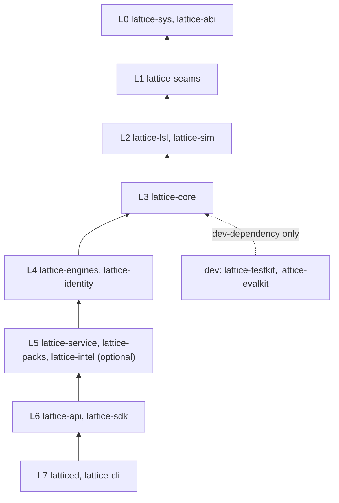
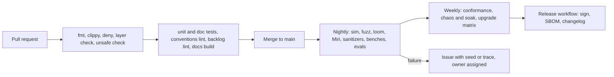
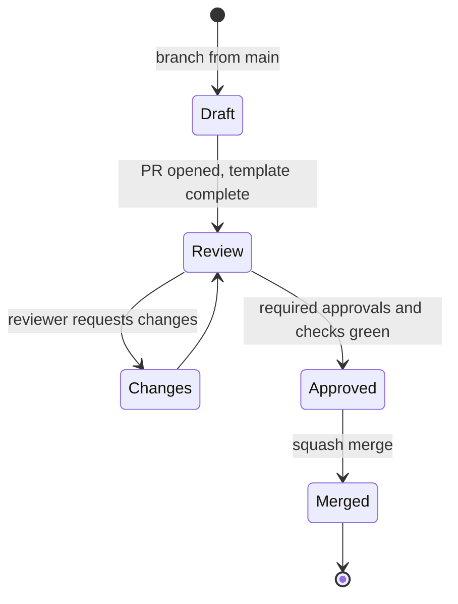

# Phase 0: repository, conventions and governance

## Goal

Create the repository and every convention that later phases rely on, so that Phase 1 can focus on correctness work and not on tooling arguments. At the end of Phase 0 the workspace compiles as empty, correctly layered skeletons; CI enforces the rules; contribution, decision and release processes exist; and every later requirement already has a home to land in.

## Scope

**In:** repository layout, Cargo workspace skeleton, toolchain and lint policy, layer enforcement, task automation, CI and release scaffolding, naming and coding conventions, commit and review rules, ADR and RFC process, governance and security files, documentation site skeleton, dependency policy, quality scaffolding directories (testkit, evalkit, benches, fuzz, formats, TLA+), backlog bootstrap.

**Out:** any database behaviour. No WAL, no LSL, no engines. Skeleton crates contain only documentation and a compile-time layer marker.

## 1. Repository layout

```text
lattice/
  Cargo.toml                workspace, [workspace.lints], [workspace.dependencies]
  rust-toolchain.toml       pinned stable toolchain, components, targets
  rustfmt.toml  clippy.toml  deny.toml  .editorconfig  .cargo/config.toml
  layers.toml               declared crate layers and allowed dependencies
  crates/
    lattice-sys/            L0  the only crate allowed to contain unsafe
    lattice-abi/            L0  stable ids, errors, wire and on-disk enums, plugin ABI
    lattice-seams/          L1  Clock, Io, Net, Rng, Spawner traits and real impls
    lattice-lsl/            L2  schema language: parser, checker, codegen
    lattice-sim/            L2  simulated seams, simulator, fault injection, scenarios
    lattice-core/           L3  kernel, typestate txn, WAL format, policy traits, all engine traits
    lattice-engines/        L4  log, row, blob, graph, vector, text, temporal (feature per engine)
    lattice-identity/       L4  OIDC, tokens, keys, relationship store
    lattice-service/        L5  scheduler, work queue, drift, reconcilers, hosts
    lattice-api/            L6  PG wire, S3, sync, OIDC endpoints, MCP, gRPC
    lattice-intel/          L5  optional models plugin (feature flag, default off)
    lattice-packs/          L5  pack runtime and bundled pack sources
    lattice-sdk/            L6  generated clients (Rust first)
    lattice-cli/            L7  admin and scripting tool
    latticed/               L7  composition root, the server binary
    lattice-testkit/        dev  oracles, generators, invariant checkers, workload generators
    lattice-evalkit/        dev  eval runner, metrics, dataset loader, reports
  web/                      lattice-web, starts from the dashboard prototype
  sidecars/                 webhook receivers, importers, delivery workers
  packs/                    pack sources written in LSL
  formats/                  on-disk and wire format specs, freeze corpus
  tla/                      TLA+ models and TLC configs
  evals/                    suites, datasets, thresholds, baselines
  benches/                  workloads, baselines, hardware profiles
  fuzz/                     cargo-fuzz targets and corpora
  xtask/                    repository automation (cargo xtask)
  backlog/                  markdown backlog until Lattice can host itself
  docs/                     site sources, ADRs (docs/adr), runbooks, this spec (docs/spec)
  .github/                  workflows, issue and PR templates, CODEOWNERS
```

### Layer rules

Layers are declared in `layers.toml` and checked by `cargo xtask check-layers` on every pull request. A crate may depend only on crates in a lower or equal declared layer that its entry allows.



`lattice-api` may call `lattice-core` directly for the write path; the diagram shows the layer order, and `layers.toml` lists the exact allowed edges.

## 2. Requirements

### A. Repository and workspace

| ID | Requirement | Verified |
|---|---|---|
| P0-01 | Repository created with the layout above; every directory has a `README.md` stating its responsibility and what it must not do | I |
| P0-02 | Cargo workspace compiles with empty skeleton crates; `cargo build --workspace` and `cargo test --workspace` pass on Linux x86_64, Linux aarch64 and macOS | T |
| P0-03 | `rust-toolchain.toml` pins one stable toolchain; a bot proposes bumps monthly; each library crate declares `rust-version` | T |
| P0-04 | `layers.toml` plus `cargo xtask check-layers` fail the build when a crate imports from a higher layer, including through dev-dependencies of non-dev crates | T |
| P0-05 | `#![forbid(unsafe_code)]` in every crate except `lattice-sys`; a CI check lists all `unsafe` blocks and fails if any appears outside `lattice-sys` | T |
| P0-06 | `[workspace.lints]` enables `clippy::unwrap_used`, `expect_used`, `indexing_slicing`, `panic` as deny in core, engines, service; warnings are errors in CI | T |
| P0-07 | `clippy.toml` bans nondeterminism in deterministic crates via `disallowed-methods` (`Instant::now`, `SystemTime::now`, `std::thread::spawn`, `tokio::spawn`, `std::fs::*`, `rand::thread_rng`) and `disallowed-types` (`HashMap`, `HashSet` with random state) | T |
| P0-08 | An allowlist file names the only crates permitted to `#[allow]` those bans (`lattice-seams`, `lattice-sys`, `latticed`, `lattice-cli`); CI fails on any other `allow` of a banned item | T |
| P0-09 | Cargo features: each engine and each optional component is a feature; `lattice-intel` is behind feature `intel`, **off by default**; CI builds and tests both with and without it once it exists | T |

### B. Conventions

| ID | Requirement | Verified |
|---|---|---|
| P0-10 | `docs/conventions.md` documents the conventions in section 3 below, and `xtask lint-conventions` enforces what can be enforced (names, metric names, config keys, ADR headers) | T, I |
| P0-11 | Conventional Commits with scopes equal to crate or directory names, enforced by a commit-message check | T |
| P0-12 | Trunk-based development: protected `main`, squash merge, linear history, required checks, no force push | I |
| P0-13 | Pull-request template requires: invariants touched, tests added, eval or benchmark deltas, format change flag, ADR link if applicable | I |
| P0-14 | `CODEOWNERS` assigns owners per layer; changes to `formats/`, `lattice-core`, policy code and `clippy.toml` require two approvals | I |
| P0-15 | ADR process: `docs/adr/NNNN-title.md`, template with status (proposed, accepted, superseded), context, decision, consequences, links; ADR index generated by xtask | T |
| P0-16 | Initial accepted ADRs exist: 0001 Rust, 0002 native engine with PG wire, 0003 inbound-only core, 0004 optional models off by default, 0005 layering and crate map, 0006 Apache-2.0 | I |
| P0-17 | RFC process for cross-cutting changes (wire, format, LSL grammar, policy model): proposal in `docs/rfc`, comment period, decision recorded as ADR | I |

### C. Tooling

| ID | Requirement | Verified |
|---|---|---|
| P0-18 | `cargo xtask` provides: `ci`, `fmt`, `lint`, `test`, `sim`, `fuzz`, `bench`, `eval`, `check-layers`, `check-format-corpus`, `traceability`, `scorecard`, `backlog`, `doctor`, `release`; unimplemented commands print "not implemented in this phase" and exit non-zero except in `ci` | T |
| P0-19 | Dev container and optional Nix flake provide the exact toolchain and tools; a new contributor reaches a green `cargo xtask ci` with one command | D |
| P0-20 | Pre-commit hooks run format, fast lint, typos and commit lint; CI is authoritative | T |
| P0-21 | Linux is the primary platform; macOS is supported for development with a portable `Io` fallback planned in Phase 1; Windows is out of scope for the server through 1.0 | I |

### D. CI and release

| ID | Requirement | Verified |
|---|---|---|
| P0-22 | Pull-request workflow (target under 15 minutes): format, clippy, deny, layer check, unsafe check, unit tests, doc tests, docs build, conventions lint, backlog lint | T |
| P0-23 | Nightly workflow scaffold: long simulation, fuzz, loom, Miri, sanitizers, benchmarks, eval suites; jobs exist and pass as no-ops until populated | T |
| P0-24 | Weekly workflow scaffold: conformance suites, chaos and soak, upgrade matrix | T |
| P0-25 | Release workflow dry run produces signed artifacts, an SBOM, and a changelog from Conventional Commits | T |
| P0-26 | Third-party actions are pinned by commit SHA; dependency update bot configured; CI secrets are minimal and scoped | I |
| P0-27 | Flaky-test policy: a flaky test is quarantined within one business day with an owner and a deadline; quarantined count appears on the scorecard | I |
| P0-28 | Required status checks configured on `main` and match the pull-request workflow job names | I |

### E. Quality scaffolding

| ID | Requirement | Verified |
|---|---|---|
| P0-29 | `lattice-testkit` and `lattice-evalkit` crates exist with documented public module structure and one trivial passing example each | T |
| P0-30 | `formats/` contains a format-spec template and an empty freeze-corpus directory; `check-format-corpus` runs and passes on the empty set | T |
| P0-31 | `tla/` contains a README, a TLC runner script and one trivial model checked in CI | T |
| P0-32 | `fuzz/` contains one trivial target that builds and runs for 10 seconds in nightly CI | T |
| P0-33 | `benches/` and `evals/` contain a README, a hardware-profile file format and a thresholds file format, each validated by xtask | T |
| P0-34 | Test naming and tagging convention is documented: tests proving an invariant carry the invariant id in their name (`inv_i1_...`); `xtask traceability` parses names and emits a matrix (empty at this point) | T |

### F. Governance, docs and security

| ID | Requirement | Verified |
|---|---|---|
| P0-35 | `LICENSE` (Apache-2.0), `NOTICE`, `CODE_OF_CONDUCT.md`, `CONTRIBUTING.md`, `GOVERNANCE.md`, `SECURITY.md` (private disclosure address, response targets), issue templates (bug, feature, question, security) | I |
| P0-36 | Documentation site skeleton builds in CI from `docs/`, includes architecture, engineering, this spec, ADR index and conventions; diagrams render | T |
| P0-37 | Secret scanning and dependency advisory scanning enabled; `cargo deny` runs on every pull request with a license allowlist and advisory denylist | T |
| P0-38 | Dependency policy: new dependency requires a justification in the PR, a license check, and a size and maintenance note; banned: `openssl` (use `rustls`), `anyhow` in core crates, `lazy_static` | T, I |
| P0-39 | Definitions of Ready and Done are written (section 4) and linked from the PR template | I |

### G. Backlog bootstrap (dogfood)

| ID | Requirement | Verified |
|---|---|---|
| P0-40 | `backlog/` item format: markdown with front matter (`id`, `type`, `state`, `requirement`, `phase`, `assignee`, `links`); `xtask backlog lint` validates it | T |
| P0-41 | `xtask backlog seed` generates one backlog item per requirement ID in `docs/spec`, idempotently | T |
| P0-42 | `xtask traceability` joins requirement IDs, backlog items, merged PRs (from commit trailers `Requirement: P1-07`) and test names into one report | T |
| P0-43 | The web prototype is moved under `web/` unchanged and builds a static bundle in CI | T |

## 3. Conventions

### Naming

| Thing | Rule |
|---|---|
| Crates | `lattice-<name>`, binary `latticed` |
| Types | `UpperCamelCase`; identifiers `Id<T>`; errors `<Crate>Error` per crate |
| Modules, functions | `snake_case`; verbs for actions, nouns for queries |
| Features | `kebab-case`, additive only |
| Metrics | `lattice_<layer>_<thing>_<unit>` (for example `lattice_core_commit_latency_seconds`) |
| Tracing targets | the crate name; every span in the write path carries `txn_id` |
| Config keys | `snake_case` TOML, grouped by section, every key documented and given a default |
| On-disk and wire enums | explicit discriminants, `#[non_exhaustive]`, never reordered |
| LSL files | `.lsl`, one pack per directory |
| Invariant tests | `inv_i<N>_<what>` |

### Errors, logging and secrets

- Per-crate `thiserror` enums; no `anyhow` in core, engines, service. Errors map to the taxonomy `Retryable`, `Rejected`, `Fatal`, `InvariantViolation` in `lattice-abi`.
- Panics are bugs. Corruption is fail-stop. No error is swallowed.
- Logs are structured (`tracing`); secrets use `Secret<T>` and never implement `Debug` output of their value.

### Versioning and compatibility

- Wire protocol, on-disk formats and the LSL grammar have independent version numbers recorded in `formats/`.
- A format or wire change requires an RFC, an ADR, a freeze-corpus update and a migration plan. Readers of version N must read all versions up to N; unknown newer versions are refused.
- Public crates follow semver and `cargo-semver-checks`.

### Code and review

- Prefer small PRs. A PR that touches two layers needs a note on why.
- Comments explain why, not what. Public items are documented; doc examples compile.
- No `TODO` without a backlog id.
- Every PR states which invariants (I1 to I14) it can affect.

### Configuration of the toolchain

- Formatting by `rustfmt` with the repository config; no manual style debates.
- Edition and toolchain pinned in `rust-toolchain.toml`; dependency versions centralized in `[workspace.dependencies]`.

## 4. Definitions

**Definition of Ready**: the item has a requirement id, acceptance criteria, the invariants it touches, the verification method, and no unresolved ADR dependency.

**Definition of Done**: code merged with passing required checks; tests of the declared verification type added; invariants touched are listed and covered; docs updated; benchmark or eval delta recorded when the change is on a hot path or uses an agent or model; backlog item closed with the commit trailer; no new `unsafe` outside `lattice-sys`.

## 5. CI pipeline overview





## 6. Exit criteria (gate for Phase 1)

| # | Criterion | Evidence |
|---|---|---|
| E0-1 | A fresh clone reaches green `cargo xtask ci` on Linux x86_64, Linux aarch64 and macOS | CI logs |
| E0-2 | Introducing a forbidden dependency edge, a forbidden `unsafe`, a banned call, and a banned dependency each fails CI (four demonstration PRs, closed unmerged) | PR links |
| E0-3 | `main` protection and required checks match the workflows | settings export |
| E0-4 | ADRs 0001 to 0006 accepted; ADR and RFC templates in use | docs site |
| E0-5 | Nightly and weekly workflows run on schedule and pass | run history |
| E0-6 | Release dry run produces signed artifacts and an SBOM | artifact list |
| E0-7 | `xtask backlog seed` creates items for all requirement IDs in this spec; `traceability` runs | report |
| E0-8 | Documentation site builds with all diagrams rendering | build log |
| E0-9 | A new contributor, not involved in setup, completes the quick start and opens a PR in under one hour | observed session |

## Depends on, risks

Depends on nothing. Risks: over-investing in tooling (limit Phase 0 to what the criteria require); lint bans too strict for real needs (the allowlist and an ADR process give an escape route that leaves a trail); CI cost (cache aggressively, keep the PR gate under 15 minutes).
