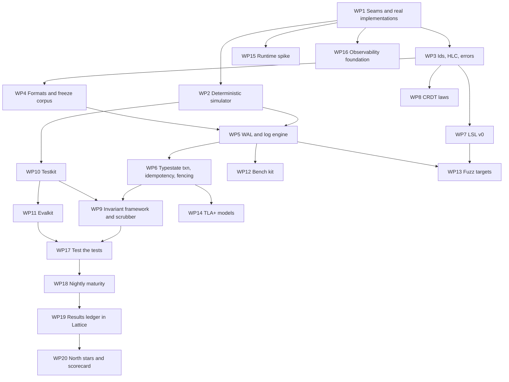
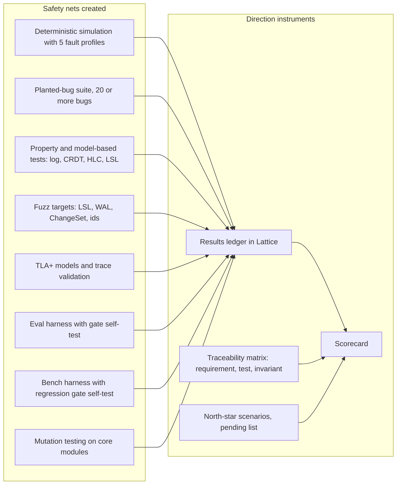

# Phase 1: foundations, evaluation and direction instruments

## Goal

Build the base everything else stands on, and prove that the base is trustworthy **before** features pile on top. Phase 1 delivers a deterministic simulation environment, a durable crash-safe log with a frozen format, the first version of the schema language, the CRDT laws, an invariant framework, an eval harness, a benchmark harness, fuzzing, formal models, and the scorecard that tells us whether we are heading the right way. It ends with a gate where the test suite itself is tested.

The rule for this phase: **nothing is considered built until a test that could have caught its absence exists.**

## Scope

**In:** seams and simulator; ids, hybrid logical clock, errors; WAL and log engine with format v1; typestate transaction skeleton with idempotency and fencing; LSL v0; CRDT register, set and text spike; invariant framework and scrubber skeleton; testkit; evalkit; bench kit; fuzz targets; TLA+ models; runtime spike; observability foundation; test-the-tests suite; nightly infrastructure; results ledger stored in Lattice's own log; north-star harness and scorecard.

**Out:** SQL, row engine, sync, identity, blobs, search, graph, any agent or model feature, any UI beyond the prototype.

## Work packages

### WP1 Seams and real implementations

| ID | Requirement | Verified |
|---|---|---|
| P1-01 | `lattice-seams` defines `Clock`, `Io`, `Net`, `Rng`, `Spawner` as traits with written contracts (ordering, error, cancellation, durability semantics of `fsync`) | I |
| P1-02 | Real implementations: `SystemClock`, portable `Io` (positioned reads, append, fsync, rename, directory sync), `TokioNet`, `OsRng`, `TokioSpawner` | T |
| P1-03 | `Io` contract states exactly when a write is durable (after `fsync` of file and, where needed, parent directory) and the contract is tested against the real implementation with a crash harness | T |
| P1-04 | All deterministic crates compile with the Phase 0 lint bans active and zero allowed exceptions | T |

### WP2 Deterministic simulator

| ID | Requirement | Verified |
|---|---|---|
| P1-05 | `lattice-sim` provides `SimClock`, `SimIo`, `SimNet`, `SeededRng`, `SimSpawner` driven by a single-threaded deterministic scheduler | T |
| P1-06 | `SimIo` fault model: crash at any point, torn write at sector granularity, lost or reordered unsynced writes, bit rot, disk full, slow disk, error injection; each fault is a named, seeded event | S |
| P1-07 | `SimNet` fault model: delay, drop, duplicate, reorder, partition, asymmetric partition, clock skew per node | S |
| P1-08 | Scenario DSL: declare nodes, workload, fault profile, invariants to check, step budget; scenarios live in `crates/lattice-sim/scenarios` | T |
| P1-09 | **Determinism self-check**: running any scenario twice with the same seed yields the same trace hash; CI runs this on random seeds | T |
| P1-10 | Failure output: seed, step number, trace, minimal reproduction command (`cargo xtask sim --seed N --scenario X`); automatic shrinking of workload and fault schedule | T |
| P1-11 | At least five fault profiles (clean, crash-heavy, disk-faulty, network-hostile, everything) with documented parameters | I |

### WP3 Ids, HLC, errors

| ID | Requirement | Verified |
|---|---|---|
| P1-12 | `Id<T>` phantom-typed ULID newtype generated through `Rng` and `Clock`; text and binary forms specified | P |
| P1-13 | Hybrid logical clock per the written algorithm in `formats/hlc.md`; properties: monotonic per node, merge never regresses, bounded drift check, total order with node tiebreak | P, S |
| P1-14 | Error taxonomy (`Retryable`, `Rejected`, `Fatal`, `InvariantViolation`) in `lattice-abi`, with a mapping rule for every crate error enum | T |

### WP4 Formats and freeze corpus

| ID | Requirement | Verified |
|---|---|---|
| P1-15 | `formats/wal-v1.md` specifies the WAL: magic, format version, record header (length, record type, LSN, CRC32C or xxh3 as chosen by ADR), payload types, segment header and footer, rotation, torn-tail rule, endianness | I |
| P1-16 | `formats/changeset-v1.md` specifies the ChangeSet envelope: ids, HLC, author, on-behalf-of, intent, causal parents, deltas, signature field | I |
| P1-17 | Freeze corpus: golden files generated by the first release; `check-format-corpus` reads every golden file with the current code; the corpus can only grow | T |
| P1-18 | Unknown newer format versions are refused with a precise error and no partial read | T |

### WP5 WAL and log engine

| ID | Requirement | Verified |
|---|---|---|
| P1-19 | Append-only segmented log with group commit, configurable sync policy, segment rotation, checksums on every record | T, S |
| P1-20 | Recovery: scan, verify, truncate torn tail, rebuild in-memory index, idempotent replay; recovery from a crash at **every** fsync boundary of a commit is tested | S |
| P1-21 | Reader API with snapshot cursors and causal ordering guarantees; readers never observe a partial record | P, S |
| P1-22 | Checkpoint skeleton: write and read a checkpoint record; recovery starts from the latest valid checkpoint | T |
| P1-23 | Model-based test: random operation sequences (append, read, crash, recover, rotate) match an in-memory oracle | P |
| P1-24 | **I1 durability**: any commit acknowledged before a crash is present after recovery, across all fault profiles | S |

### WP6 Typestate transaction, idempotency, fencing

| ID | Requirement | Verified |
|---|---|---|
| P1-25 | `Txn<State>` typestate: `Open`, `Validated`, `Authorized`, `Prepared`, `Logged`, `Durable`, `Applied`, `Published`; calling out of order does not compile (compile-fail tests) | T |
| P1-26 | `Validated<T>` and `Authorized<Action>` are constructible only by the validator and policy modules (stubs allow-all in Phase 1, replaced in Phases 2 and 4) | T |
| P1-27 | Single ordered commit pipeline with bounded queues and backpressure; writers never block readers | S |
| P1-28 | **I6 idempotency**: client-assigned ChangeSet ids; resubmission returns `duplicate`, writes nothing, across crashes | S |
| P1-29 | **I12 fencing**: turn ids; a write from a superseded turn returns `fenced` and writes nothing | S |

### WP7 LSL v0

| ID | Requirement | Verified |
|---|---|---|
| P1-30 | Grammar spec `formats/lsl-grammar-v0.md`: scalar types, enums, lists, optional, refs, facets, composed types, annotations (parsed, mostly unused), comments | I |
| P1-31 | Parser with source spans and recoverable errors; diagnostics are stable and snapshot-tested | T |
| P1-32 | Type checker: name resolution, facet composition conflicts, ref targets, enum exhaustiveness, refinement ranges | T, P |
| P1-33 | Validator generation: an interpreted validator for a payload against a compiled type; **I8** holds for every payload accepted by the validator | P, F |
| P1-34 | Compatibility checker: classifies a change as backward compatible, forward compatible, both or breaking, with documented rules | P |
| P1-35 | Migration lenses v0: `up` and `down` transforms for field rename, add with default, widen; round-trip property test where declared lossless | P |
| P1-36 | Formatter and `lsc check` CLI; parser round trip (`format(parse(x))` is stable) | P |

### WP8 CRDT laws

| ID | Requirement | Verified |
|---|---|---|
| P1-37 | Last-writer-wins register ordered by HLC and node id, observed-remove set, and a spike of a text sequence CRDT behind a `Crdt` trait | T |
| P1-38 | Property laws for each type: commutative, associative, idempotent merge; convergence under every delivery order for generated op sets | P |
| P1-39 | Simulated convergence: replicas with reordered, duplicated, delayed delivery converge (**I5**) | S |
| P1-40 | Text CRDT build-or-adopt ADR with measured criteria: laws pass, memory per character, merge cost, document size growth, licence | B, I |

### WP9 Invariant framework and scrubber skeleton

| ID | Requirement | Verified |
|---|---|---|
| P1-41 | `Invariant` trait and registry in testkit with checkers for I1, I2 (log level), I4, I6, I8, I12, I13; each checker runs in simulation and as an online check | T, S |
| P1-42 | `#[invariant(I<N>)]` test attribute (or naming convention) feeds `xtask traceability`; the matrix lists, per invariant, enforcement and verification status | T |
| P1-43 | Audit hash chain primitive and verifier (**I13**), with tamper-detection tests | P |
| P1-44 | Scrubber skeleton: a background job interface that rebuilds a derived structure from the log and diffs it (**I9**); first instance validates the log index; `lattice doctor` v0 runs scrubbers on a data directory | T |

### WP10 Testkit

| ID | Requirement | Verified |
|---|---|---|
| P1-45 | Oracles (log), workload generators with shrinkers, golden-file helpers, snapshot helpers, fixture builders; all documented | T |
| P1-46 | `proptest` regression files are committed; a failing seed is never lost | I |

### WP11 Evalkit

| ID | Requirement | Verified |
|---|---|---|
| P1-47 | Dataset manifest format (content hash, version, split, provenance, license, privacy class) and loader that refuses unhashed or modified data | T |
| P1-48 | `Provider` trait (the thing under evaluation: rule, agent, model) and `Suite` trait (dataset plus metrics plus thresholds) | T |
| P1-49 | Metrics library: precision, recall, F1, exact and overlap span match, B-cubed, false-merge rate, ECE and reliability bins, risk-coverage curve, nDCG, MRR, recall@k, latency percentiles, cost; **bootstrap confidence intervals with a seed** | T, P |
| P1-50 | Thresholds file format (metric, lower bound, tolerance, confidence level) and a gate that exits non-zero on failure and writes a report | T |
| P1-51 | Reports: JSON and HTML, byte-identical for identical inputs and seed | T |
| P1-52 | Mutation-based dataset generator prototype: takes a synthetic workspace snapshot, applies named mutations (change number, rename entity, contradict sentence, move file), emits ground truth | T |
| P1-53 | Three seed suites: toy extraction (rule provider), drift injection (oracle provider), calibration (synthetic scores); **harness self-test**: a deliberately bad provider must fail the gate and a perfect provider must pass it | E |

### WP12 Bench kit

| ID | Requirement | Verified |
|---|---|---|
| P1-54 | `criterion` benches for WAL append, group commit, recovery scan, HLC tick, LSL parse and check, CRDT merge; workloads in `benches/` with hardware profiles | B |
| P1-55 | Baselines stored per hardware profile; regression gate with tolerance defined in the thresholds file | B |
| P1-56 | A deliberately injected 20 percent slowdown is detected by the gate (gate self-test) | B |

### WP13 Fuzz targets

| ID | Requirement | Verified |
|---|---|---|
| P1-57 | Structure-aware targets: LSL parser and checker, WAL record decoder, segment scanner, ChangeSet decoder, ULID and HLC decoders, CRDT op decoders | F |
| P1-58 | Seed corpora committed; every fixed crash adds a regression input; nightly runs each target for a fixed budget | F |

### WP14 TLA+ models

| ID | Requirement | Verified |
|---|---|---|
| P1-59 | Models checked by TLC in nightly CI: commit protocol with crash (durability, atomicity), HLC causality, set CRDT convergence, turn fencing | I |
| P1-60 | Trace validation prototype: a WAL trace from simulation is replayed against the commit model and accepted | T |
| P1-61 | State bounds and what the models do not cover are documented next to each model | I |

### WP15 Runtime spike

| ID | Requirement | Verified |
|---|---|---|
| P1-62 | Prototype `UringIo` behind the `Io` trait on Linux; benchmark commit and read workloads against the portable `Io` and a tokio-based variant | B |
| P1-63 | Decision ADR on the engine runtime with data, the decision criteria written before measuring | I |

### WP16 Observability foundation

| ID | Requirement | Verified |
|---|---|---|
| P1-64 | `tracing` setup with `txn_id` spans, metrics registry with the naming rule, `Secret<T>` with zeroize and redacted formatting | T |
| P1-65 | Log and trace output verified to contain no secret values in a test that logs every `Secret` type | T |

### WP17 Test the tests

| ID | Requirement | Verified |
|---|---|---|
| P1-66 | **Planted-bug suite**: at least 20 deliberately injected defects (skip fsync, wrong checksum range, reorder apply and ack, forget dedupe write, HLC regression on merge, accept torn tail, drop fenced check, skip migration lens, off-by-one in segment rotation, and others), each toggled by a feature flag in a test build | S |
| P1-67 | For every planted bug the simulator or another named test layer detects it within the seed budget, and the failing invariant is the expected one | S |
| P1-68 | On the clean build, zero violations across the same budget (no false alarms) | S |
| P1-69 | Mutation testing (`cargo-mutants` or equivalent) on `lattice-core` WAL, HLC and txn modules and on `lattice-lsl`; surviving mutants are triaged, each either killed by a new test or recorded as equivalent | T |
| P1-70 | Coverage is measured and published as information; it is never a gate by itself | I |

### WP18 Nightly maturity

| ID | Requirement | Verified |
|---|---|---|
| P1-71 | Nightly runs: at least 1,000,000 simulation seeds spread over all fault profiles, long model-based tests, all fuzz targets, loom, Miri on `lattice-sys`, sanitizers, benchmarks against baselines, evals, TLC | T |
| P1-72 | Any nightly failure opens an issue with seed, scenario, trace and owner; the failure count is on the scorecard | T |
| P1-73 | Determinism and flakiness: a test that fails once and passes on rerun without code change is a defect with the same priority as a failure | I |

### WP19 Results ledger in Lattice

| ID | Requirement | Verified |
|---|---|---|
| P1-74 | Simulation summaries, benchmark results and eval reports are appended to a Lattice log file as ChangeSets with the Phase 1 envelope (first dogfooding of the log engine) | T |
| P1-75 | `xtask scorecard` reads the ledger, not CI logs, and renders the scorecard; the ledger passes `lattice doctor` | T |

### WP20 North stars and scorecard

| ID | Requirement | Verified |
|---|---|---|
| P1-76 | North-star scenarios NS1 to NS8 from [direction.md](direction.md) exist as executable specifications: each is a test marked pending with the phase that makes it pass, and the pending list is on the scorecard | T |
| P1-77 | Scorecard sections: engineering health, invariant coverage, simulation, fuzz, mutation, eval gates, benchmarks, risk register status, north-star readiness, dogfood measures | T |
| P1-78 | Phase gate review package generated by `xtask gate --phase 1` (evidence list for every exit criterion below) | T |

## Test, eval and benchmark inventory added in Phase 1

## Exit criteria (gate for Phase 2)

All MUST criteria must pass. Numeric thresholds are proposals, frozen by ADR at the gate.

| # | Criterion | Evidence |
|---|---|---|
| E1-1 | **Determinism**: 100 percent of at least 10,000 random seeds reproduce an identical trace hash on rerun | determinism report |
| E1-2 | **Simulation**: at least 1,000,000 seeds across all profiles per night, zero violations of I1, I2 (log level), I4, I6, I12, I13 for seven consecutive nights | nightly ledger |
| E1-3 | **Planted bugs**: at least 20 bugs, at least 95 percent detected within 100,000 seeds each with the expected failing invariant, zero false alarms on the clean build | planted-bug report |
| E1-4 | **Crash recovery**: recovery is idempotent and correct for a crash at every fsync boundary in at least 100 scenarios, including torn tails | simulation report |
| E1-5 | **CRDT laws**: register, set and text types pass at least 10,000 cases per law in PR runs and at least 1,000,000 nightly | property report |
| E1-6 | **Fuzz**: each target has at least 24 cumulative hours with no panic, hang, out-of-memory or corruption; corpora committed | fuzz report |
| E1-7 | **Mutation score**: at least 80 percent on WAL, HLC and txn modules and at least 70 percent on `lattice-lsl`, survivors triaged | mutation report |
| E1-8 | **Eval harness**: gate self-test passes (bad provider fails, perfect provider passes); reports are byte-identical for identical inputs; bootstrap intervals reproducible by seed | eval report |
| E1-9 | **Bench harness**: baselines recorded on the reference hardware profile; the injected 20 percent slowdown is caught | bench report |
| E1-10 | **Format**: WAL, ChangeSet and HLC specs accepted by ADR; freeze corpus v1 committed and read in CI | corpus check |
| E1-11 | **Formal models**: TLC passes all four models with documented bounds; WAL trace validation works | TLC logs |
| E1-12 | **Runtime**: engine runtime ADR accepted with benchmark data | ADR |
| E1-13 | **Unsafe discipline**: zero `unsafe` outside `lattice-sys`; Miri passes on `lattice-sys`; loom tests exist for every atomic structure | CI logs |
| E1-14 | **Traceability**: all of I1 to I14 appear in the matrix with a planned enforcement and verification; I1, I2 (log), I4, I6, I8, I12, I13 are fully implemented and tested | matrix |
| E1-15 | **Scorecard and ledger**: scorecard generated from the ledger; ledger verified by `lattice doctor` | scorecard |
| E1-16 | **Direction**: gate review held, risk register updated, NS1 to NS8 scenarios exist as pending specs with owning phases, go or no-go recorded | gate package |

**Kill or pivot triggers** at this gate (see [direction.md](direction.md)): if simulation cannot be made deterministic (E1-1 fails after two remediation cycles), stop and revisit the simulation strategy before any feature work; if planted-bug detection stays under 80 percent, the test strategy is not strong enough to build a database on.

## Depends on, risks

Depends on Phase 0. Risks: determinism is easy to break with a stray call (mitigated by lint bans and the self-check); simulation does not model real kernel and disk behaviour (mitigated by the crash harness on real storage, WP1, and by Phase 10 chaos); over-building eval and scorecard machinery before there is anything to measure (mitigated by keeping WP11 and WP20 to the listed scope and proving them with synthetic data); LSL scope creep (v0 stays small, the grammar grows by RFC).
