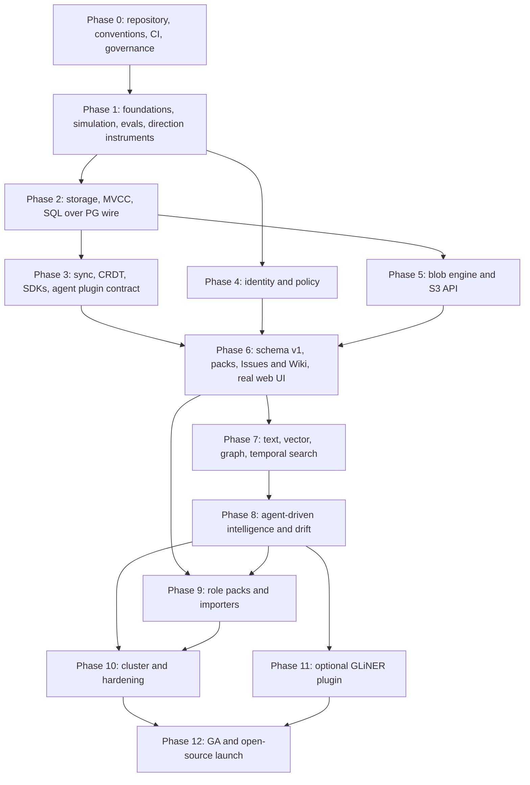
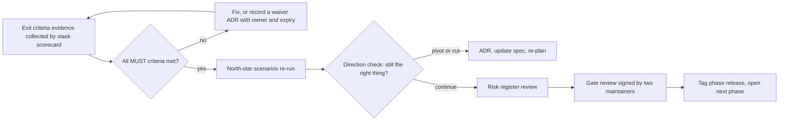

# Lattice specification: phased delivery plan

This is the build specification for Lattice, derived from [ARCHITECTURE.md](../ARCHITECTURE.md) and [ENGINEERING.md](../ENGINEERING.md). It is split into phases. **Phase 0** creates the repository and every convention. **Phase 1** builds the foundations that make everything after it trustworthy: deterministic simulation, durable log, schema language, test and eval harnesses, and the instruments that tell us whether we are heading the right way. Phases 2 to 12 add capability on top, each gated by evidence.

All numeric thresholds in this spec are **proposals**. Phase 1 records baselines, and thresholds are then frozen by ADR. Where this spec says MUST, SHOULD or MAY it follows RFC 2119 meaning.

## 1. How to read a phase document

Every phase document has the same shape.

| Section | Content |
|---|---|
| Goal | One paragraph on why the phase exists |
| Scope | What is in and what is explicitly out |
| Requirements | Table of `ID`, requirement, verification method |
| Tests, evals, benchmarks added | What the phase adds to the safety net |
| Exit criteria | Measurable conditions for the phase gate |
| Depends on, risks | Ordering and what could go wrong |

**Requirement IDs** use `P<phase>-<nn>`, for example `P1-07`. They are stable, and the repository seeds one backlog item per ID so every requirement traces to a pull request and a test.

**Verification codes**: `T` automated test, `S` deterministic simulation, `P` property or model-based test, `F` fuzzing, `E` eval, `B` benchmark, `I` inspection or review, `D` demo, `C` conformance suite.

## 2. Phase map

| Phase | Document | Relative size |
|---|---|---|
| 0 | [Repository and conventions](00-repo-and-conventions.md) | M |
| 1 | [Foundations](01-foundations.md) | XL |
| 2 | [Storage and SQL](02-storage-and-sql.md) | XL |
| 3 | [Sync, CRDT, SDKs](03-sync-and-sdk.md) | L |
| 4 | [Identity and policy](04-identity-and-policy.md) | L |
| 5 | [Blob engine and S3](05-blob-and-s3.md) | L |
| 6 | [Schema, packs, web](06-schema-packs-web.md) | XL |
| 7 | [Search, graph, temporal](07-search-graph-temporal.md) | L |
| 8 | [Intelligence and drift](08-intelligence-and-drift.md) | XL |
| 9 | [Role packs and import](09-role-packs-and-import.md) | L |
| 10 | [Cluster and hardening](10-cluster-and-hardening.md) | XL |
| 11 | [Optional models](11-optional-models.md) | M |
| 12 | [GA and launch](12-ga-and-oss-launch.md) | M |
| All | [Direction: north stars, scorecard, gates, risks](direction.md) | n/a |

Phases 2, 4 and 5 can run in parallel after Phase 1 if there are enough people; Phase 3 needs Phase 2; Phase 6 needs 3, 4 and 5.

## 3. The phase gate

No phase starts its successor's critical work until its **gate** passes. A gate is an evidence review, not a meeting about feelings.

A **waiver** is allowed only for a SHOULD criterion or a numeric threshold, never for an invariant, and expires at the next gate.

## 4. Decisions deliberately deferred

These are named so they are decided with evidence, in the owning phase, by ADR.

| Decision | Owning phase | Options |
|---|---|---|
| Async runtime for engines | 1 | tokio, thread-per-core with io_uring |
| Text CRDT: build or adopt | 1 | own implementation, existing Rust CRDT library |
| Simulation framework | 1 | custom executor, `madsim`, `turmoil` |
| SQL planner: build or adopt | 2 | custom, `sqlparser` plus DataFusion |
| Postgres dialect coverage | 2 | documented subset, wider coverage |
| Graph query language | 7 | SQL graph patterns, Cypher subset |
| Web framework | 6 | vanilla and web components, a framework |
| Cluster ships in v1 | 10 | yes, single-node first with cluster in 1.x |

## 5. Conventions used across the spec

- "The core" means the `lattice-core` crate and everything below it in the layer order. It never opens outbound connections.
- Intelligence is a slot. Agents fill slots by default through the work queue; the GLiNER models are an optional plugin that is **off by default** (Phase 11).
- Every phase adds to three safety nets, never removes: invariants and simulation, evals, and the scorecard.
